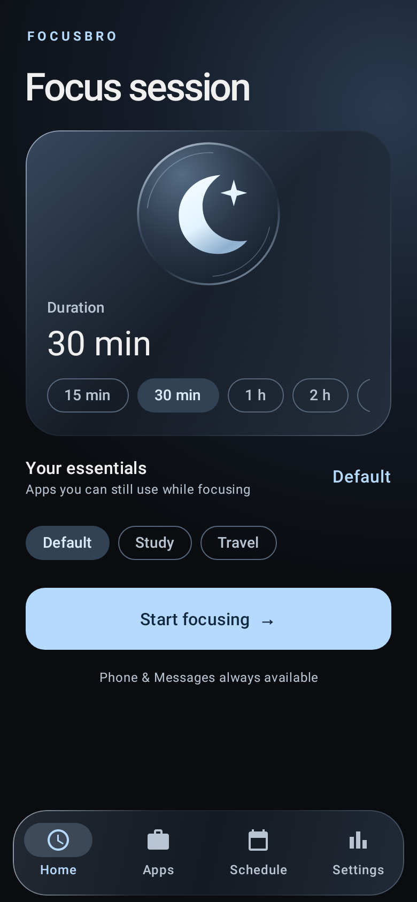

# FocusBro

FocusBro is an offline Android focus timer. Choose which apps stay available, start a session, or schedule a recurring routine. The optional accessibility service returns you to the timer when you open a restricted app. Android Settings, phone and messaging remain available.

## Android release

[Signed FocusBro 1.2.0 app bundle](release/FocusBro-1.2.0-release.aab) · [Release details](release/README.md) · [Privacy policy](PRIVACY_POLICY.md)

Package: com.focusbro.myapp. Minimum Android 8 (API 26). Target Android 16 (API 36).

## Build and verify

Install JDK 17 and Android SDK platform 36. Point ANDROID_HOME or local.properties at the SDK. From the repository root run:

    ./gradlew assembleDebug testDebugUnitTest lintRelease

Use gradlew.bat on Windows. The Robolectric tests on Windows ARM require an x64 JDK. To build a signed Play bundle, configure the existing upload key through the ignored keystore.properties file or set FOCUSBRO_SIGNING_PROPERTIES to its path, then run:

    ./gradlew bundleRelease

Signing properties are storeFile, storePassword, keyAlias and keyPassword. Relative key paths resolve from the properties file. Keep signing credentials outside version control.
